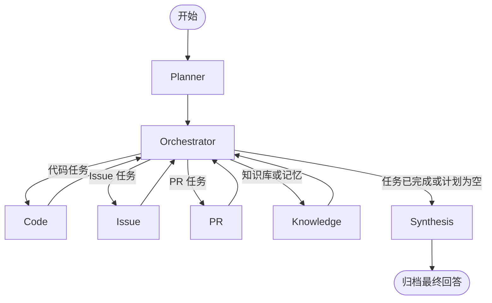

# LangGraph 多 Agent 编排

`AGENT_MODE=multi` 现在实际调用 LangGraph `StateGraph`，不是手写循环调度。入口保持为 `agent.run_agent()`，HTTP `/chat` 和 SSE `/chat/stream` 均使用同一条执行链；模型连接配置与 MCP 工具定义无需修改。



## 实现位置

- `orchestration.py`：状态定义、运行上下文、节点函数、条件路由、编译后的 `WORKFLOW_GRAPH` 与 `ainvoke()` 入口。
- `agent.py`：根据 `AGENT_MODE` 选择执行模式，继续提供角色受限的模型/工具循环。
- `tests/test_langgraph.py`：运行真实编译图，验证节点顺序、重复角色任务、空计划、运行上下文隔离、记忆范围、MCP 生命周期、SSE、失败和取消。
- `scripts/check_full_stack.py`：真实聊天模型、MCP、本地 Embedding、Milvus 与 PostgreSQL 的完整链路验收，要求 SSE 状态中出现实际 LangGraph 节点。

`WorkflowState` 包含输入消息、任务计划、当前任务位置、专用 Agent 发现、真实工具证据与最终答案。节点返回部分状态更新；Orchestrator 通过条件边选择下一个角色。任务顺序与 Planner 的计划一致，允许多项任务使用同一个角色。

`WorkflowContext` 按每次调用独立创建，传入 MCP 会话、知识库绑定、SSE 回调与 commit pins。连接对象和回调不进入图状态。编译图可复用，各会话不共享任务、证据或 pins；记忆工具继续读取当前会话的 `ContextVar` 范围。

## 限制与提交边界

Planner 最多创建 3 个任务；每个专用 Agent 保留最多 8 次工具调用预算。图设置 12 步上限，正常最长路径执行 9 个节点。角色权限仍由服务端工具白名单限制。中间 Agent 文本不输出为最终回答，只流式传输综合 Agent 的回答。

多 Agent 的编排层使用 LangGraph；专用 Agent 内部的模型/工具循环仍是现有 `_run_agent()`。`AGENT_MODE=single` 保留原有单 Agent 实现。

当前未启用 LangGraph checkpointer、断点恢复或人工审批中断。PostgreSQL/SQLite 的会话归档仍由 `ConversationStore.chat()` 在整图成功后统一提交。中途错误或取消不提交半轮会话，不自动重试节点。图状态也不会作为数据库备份。

节点进度沿用现有 SSE `status` 事件，补充 `orchestration=langgraph` 和 `node`；工具事件仍是 `tool_start` / `tool_end`，同轮不同专用 Agent 的工具事件 ID 独立，避免前端覆盖。图完整状态、内部报告和连接上下文不会直接推送给浏览器。

## 运行与检查

```powershell
.\.venv\Scripts\python.exe -m pip install -r requirements.lock
# .env 中设置 AGENT_MODE=multi，重启后端。
.\.venv\Scripts\python.exe -m uvicorn main:app --host 127.0.0.1 --port 8000 --workers 1

# 离线回归；图测试内部会显式启用 multi：
$env:AGENT_MODE='single'
.\.venv\Scripts\python.exe -m unittest discover -s tests -q

# 使用已配置的模型与数据库，创建并清理临时验收资料：
.\.venv\Scripts\python.exe scripts/check_full_stack.py

# 输出编译图的真实 Mermaid 拓扑：
.\.venv\Scripts\python.exe -c "from orchestration import WORKFLOW_GRAPH; print(WORKFLOW_GRAPH.get_graph().draw_mermaid())"
```

依赖锁定为 LangGraph 1.2.18，Python 3.12。状态、节点、条件边与运行上下文的用法参考 [LangGraph Graph API 官方文档](https://docs.langchain.com/oss/python/langgraph/graph-api)。不需要 LangSmith 账号或服务来运行本项目。
